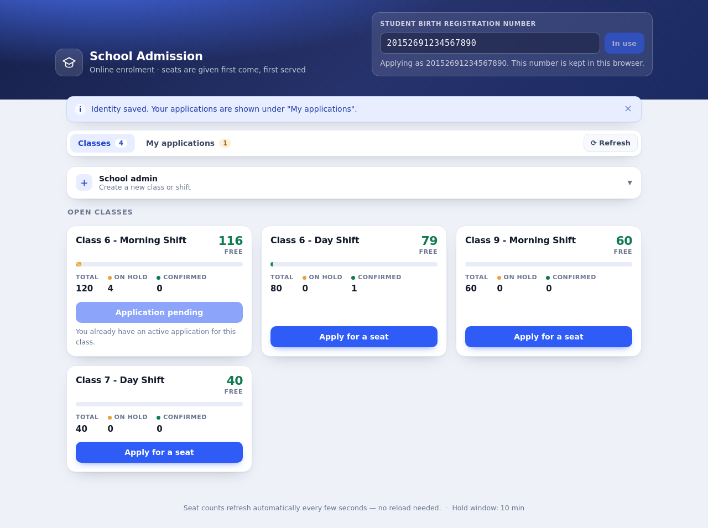
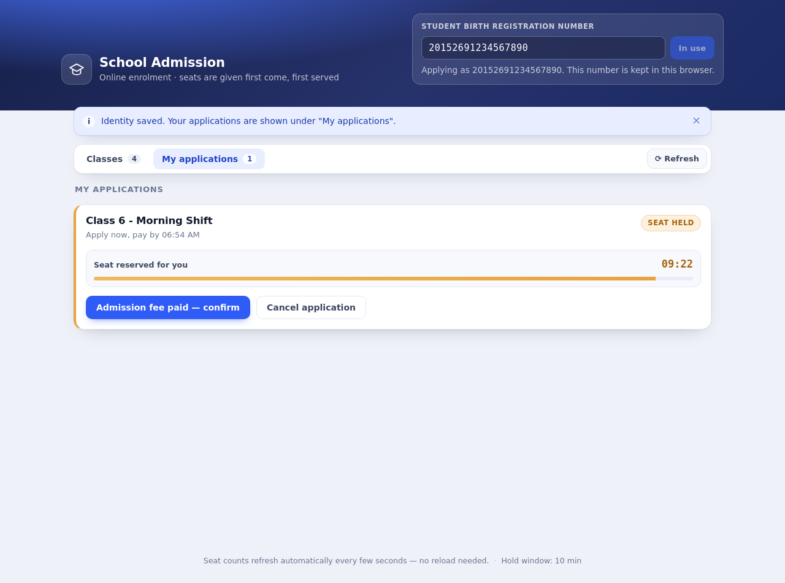

# School Admission System

Online, first-come-first-served school admission. A parent holds a seat by applying, then
confirms the admission by paying the fee before the hold window runs out; if they do not, the
seat is released automatically for someone else.

* **Backend** — C# / .NET 8 minimal API, PostgreSQL (Npgsql + Dapper), row-level locking for the
  seat-allocation invariant, background sweeper that releases expired holds.
* **Frontend** — React 18 + TypeScript + Vite. No login: the student's 17-digit birth
  registration number is the identity.
* **Everything runs with Docker Compose** — PostgreSQL, backend and frontend.

---

## 1. Run it

```bash
docker compose up --build
```

| What | URL |
|------|-----|
| **UI (open this one)** | <http://localhost:3000> |
| API | <http://localhost:8080/> |
| PostgreSQL | `localhost:5432` (`school` / `school`, database `school_admission`) |

Nothing else has to be installed — no .NET SDK, no Node, no local PostgreSQL.
Stop with `docker compose down`; data survives because it lives in the `db-data` volume.
`docker compose down -v` also deletes the data.

Optional settings (environment variables):

| Variable | Default | Meaning |
|---|---|---|
| `HOLD_DURATION_SECONDS` | `600` | How long a held seat stays reserved |
| `DB_MAX_POOL_SIZE` | `20` | Connection-pool cap per backend process |
| `VITE_API_BASE_URL` | *(empty)* | Where the browser sends API calls. Empty = same origin, nginx proxies to the backend. Set it (e.g. `http://localhost:8080`) to point the UI at a backend elsewhere. Under the hood it is `ConnectionStrings__Default` for the database and `VITE_API_BASE_URL` for the frontend, so both are environment-driven. |

```bash
# e.g. a 2 minute payment window
HOLD_DURATION_SECONDS=120 docker compose up --build
```

### Screens

| Classes (with live seat counters) | My applications (live countdown) |
|---|---|
|  |  |

### Try it

1. Open <http://localhost:3000>.
2. As *school admin*, create `Class 6 - Morning Shift` with, say, 3 seats.
3. Type a 17-digit birth registration number (any 17 digits work, e.g. `20152691234567890`).
4. Press **Apply for a seat** → you get a hold with a live countdown.
5. Press **Admission fee paid — confirm** (the payment is simulated) → admission confirmed.
6. Apply with another number and let the timer run out: the application turns **Expired** on its
   own, the pay button disables, and the seat is available again — no reload needed.

---

## 2. Running the tests

### Backend (21 tests, including concurrency)

The API tests need a PostgreSQL server they can create a throw-away database on. The easiest
way is the database from `docker compose`:

```bash
docker compose up -d db          # starts PostgreSQL on localhost:5432
cd backend
dotnet test                      # or: dotnet test tests/SchoolAdmission.Tests
```

Point the tests somewhere else with `TEST_POSTGRES_ADMIN` (the user needs `CREATEDB`):

```bash
TEST_POSTGRES_ADMIN="Host=localhost;Port=5432;Database=postgres;Username=school;Password=school" dotnet test
```

What is covered:

| Test | What it proves |
|---|---|
| `ClassesApiTests` | create/list/get contract, seat counters, 400/404 handling |
| `HoldsApiTests` | hold → confirm → cancel flow, "no overbooking", one active application per student per class, idempotent confirm, ownership checks, header validation |
| `HoldsApiTests.Expired_holds_release_their_seat_without_any_client_call` | the seat really comes back with **no API call at all** (the test waits, then reads the status straight from PostgreSQL) |
| `ConcurrencyTests.Many_simultaneous_applications_never_oversell_the_class` | 60 simultaneous applications for 10 seats → exactly 10 × `201`, 50 × `409` |
| `ConcurrencyTests.Two_backend_instances_sharing_one_database_still_respect_the_seat_limit` | the same with **two API hosts on one database** (the "two processes" scenario) |
| `ConcurrencyTests.Simultaneous_confirmations_of_one_application_count_the_seat_once` | 20 parallel confirms → `confirmedSeats == 1` |
| `ConcurrencyTests.Concurrent_expiry_sweeps_and_expired_holds_never_exceed_capacity` | read/apply traffic mixed with the expiry sweeper keeps `held + confirmed <= totalSeats` |

### Frontend (13 tests, Vitest + Testing Library)

```bash
cd frontend
npm ci
npm test
```

---

## 3. API
Swagger URL `http://localhost:8080/swagger`, JSON only and
Base URL `http://localhost:8080`, JSON only, student identity in the `X-Student-Id` header
(17 digits). Responses may contain extra fields, the required ones are always present.

| # | Method & path | Purpose |
|---|---|---|
| 1 | `POST /classes` | create a class (`{ "name": "...", "totalSeats": 120 }` → `201`) |
| 2 | `GET /classes` | all classes with `heldSeats` / `confirmedSeats` / `availableSeats` |
| 3 | `GET /classes/{classId}` | seat state of one class |
| 4 | `POST /classes/{classId}/holds` | apply → seat held (`201`), `409` when full |
| 5 | `GET /holds/{holdId}` | current state (`HELD` / `CONFIRMED` / `EXPIRED` / `CANCELLED`) |
| 6 | `POST /holds/{holdId}/confirm` | simulated payment → `CONFIRMED` (idempotent) |
| 7 | `DELETE /holds/{holdId}` | cancel (`204`) |
| 8 | `GET /me/holds` | all applications of this student |

Every class *and* shift is its own class with its own seat pool (`Class 6 - Morning Shift` and
`Class 6 - Day Shift` are two classes). Errors always come back as JSON:

```json
{ "error": "NO_SEATS_AVAILABLE", "code": "NO_SEATS_AVAILABLE", "message": "Sorry, this class is full. No seats are available." }
```

Next to the contract there is `GET /health` (used by the UI to align its countdown clock with
the server and to read `HOLD_DURATION_SECONDS`).

---

## 4. How the seat rule is enforced

```
BEGIN;                                                    -- one transaction per application
  SELECT ... FROM school_classes WHERE id = $1 FOR UPDATE; -- lock this class' row
  UPDATE holds SET status='EXPIRED' WHERE class_id=$1 AND status='HELD' AND expires_at <= now();
  SELECT count(*) FILTER (WHERE status='HELD'), count(*) FILTER (WHERE status='CONFIRMED') ...
  -- 409 when the student already has an active application / confirmed seat
  -- 409 when held + confirmed >= total_seats
  INSERT INTO holds (...) VALUES (..., now() + make_interval(secs => $duration));
COMMIT;
```

The class row lock serialises allocation **per class** — across threads, across requests and,
because the lock lives in PostgreSQL, across separate backend processes. Seat counts are always
derived from the `holds` table (no denormalised counters that could drift), and a partial unique
index (`(class_id, student_id) WHERE status IN ('HELD','CONFIRMED')`) is a last-resort safety
net at the database level. The reasoning and trade-offs behind it are written down in [ASSUMPTIONS.md](ASSUMPTIONS.md).

Seats also come back **without any client request**: a background worker flips every overdue
`HELD` row to `EXPIRED` once a second, and every read computes its counts from the clock, so
even between sweeps an expired hold no longer occupies a seat.

---

## 5. Layout

```
.
├── docker-compose.yml          # PostgreSQL + backend + frontend
├── run-local.sh / .ps1         # run all three locally, without Docker
├── ASSUMPTIONS.md              # what the brief left open and what I decided
├── AI_USAGE.md                 # which AI help was used, and what it got wrong
├── backend/
│   ├── Dockerfile
│   ├── SchoolAdmission.sln
│   ├── src/SchoolAdmission.Api/
│   │   ├── Program.cs                 # composition root, startup, DB wait
│   │   ├── Endpoints/                 # minimal-API routes + central error handling
│   │   ├── Services/AdmissionService.cs   # all business rules + locking SQL
│   │   ├── Data/                      # connection factory, schema bootstrap
│   │   ├── BackgroundServices/        # expiry sweeper
│   │   └── Domain/                    # entities, DTOs, validation
│   └── tests/SchoolAdmission.Tests/   # xUnit + WebApplicationFactory + real PostgreSQL
└── frontend/
    ├── Dockerfile, nginx.conf
    └── src/
        ├── App.tsx                    # screens, polling, actions
        ├── api.ts                     # typed API client, friendly error mapping
        ├── components/                # class list, create form, hold card, identity bar
        └── hooks/                     # polling + server clock
```

## 6. Run without Docker (local development)

The assignment is graded through Docker, but you can also run the three processes directly on a
machine that already has **.NET 8 SDK + Node 18+ + PostgreSQL 16+** installed:

```bash
./run-local.sh              # Linux / macOS
```

```powershell
powershell -ExecutionPolicy Bypass -File .\run-local.ps1     # Windows
```

The script is idempotent and does everything: starts PostgreSQL if needed, creates the `school`
role and `school_admission` database, restores NuGet packages, installs frontend dependencies,
starts the API on `http://localhost:8080` and the UI on `http://localhost:5173`, waits until both
are healthy and then mirrors their logs. `Ctrl+C` (or `./run-local.sh --stop`) stops them again.

Ports, database credentials and the hold window can be overridden without editing the script:

```bash
DB_USER=me DB_PASSWORD=secret BACKEND_PORT=8090 FRONTEND_PORT=4000 HOLD_DURATION_SECONDS=120 ./run-local.sh
```

Logs and PID files land in `.run/` (git-ignored).

**Docker vs. no Docker:** `docker-compose.yml` stays the supported, graded way to run this — it
needs nothing installed on the host, and that is what the brief asks for. `run-local.sh` /
`run-local.ps1` are a convenience for development (faster restart, debugger attach, `--skip-install`
runs). Nothing in the application code depends on Docker.

### Manual start (if you prefer doing it by hand)

```bash
# backend (needs the PostgreSQL from `docker compose up -d db`, or a local one)
cd backend
ConnectionStrings__Default="Host=localhost;Port=5432;Database=school_admission;Username=school;Password=school" \
  dotnet run --project src/SchoolAdmission.Api

# frontend (proxies /classes, /holds, /me, /health to http://localhost:8080)
cd frontend
npm install && npm run dev        # http://localhost:5173
```

# Backend API with Swagger (proxies /classes, /holds, /me, /health to http://localhost:8080/swagger)


