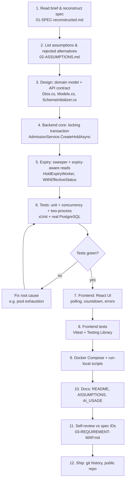

# Interview Guide — School Admission System

> A single document I can use to walk an interviewer through what I built, how I built it,
> why I used an agentic AI, and what I can defend line by line. Everything below is grounded
> in the code in this repository (`backend/`, `frontend/`) and in `ASSUMPTIONS.md`,
> `AI_USAGE.md`, `README.md`.

---

## 1. One-paragraph summary (the elevator pitch)

I built an online, first-come-first-served school admission system: a .NET 8 minimal API
backed by PostgreSQL with row-level locking for the seat-allocation invariant, plus a React 18
+ Vite UI. A parent holds a seat by applying (17-digit birth registration number = identity,
no login), then confirms by paying before a configurable hold window (default 600 s) runs out;
if they do not pay, the seat is released automatically with no client call. The whole stack runs
with `docker compose up`. The hard part is the invariant: **`held + confirmed` must never
exceed `totalSeats`, no matter how many requests arrive at once, even across two backend
processes sharing one database.** I guarantee that with a `SELECT ... FOR UPDATE` on the class
row inside one transaction, plus a partial unique index as a database-level safety net.

---

## 2. SDLC flow (how the work actually happened)



Key discipline points I can defend:

- **Spec first, code second.** I reconstructed the PDF into a numbered spec (`S1…SUB5`) before
  writing code, so every requirement has a stable ID I can trace.
- **Assumptions written down with rejected alternatives** (`ASSUMPTIONS.md`), because the brief
  is deliberately silent on cancel/confirm/expiry edges.
- **Tests before trust.** Concurrency tests run against **real PostgreSQL**, not an in-memory
  fake, because the invariant lives in the database lock.
- **Commits as work happened** (10 commits, incremental — see `git log`), not one big dump.

---

## 3. Architecture & tools used

| Layer | Technology | Why |
|---|---|---|
| Backend | C# / .NET 8 minimal API | Brief mandates .NET 8+; minimal API keeps the surface small |
| Database | PostgreSQL 16 (Npgsql + Dapper) | Brief mandates PostgreSQL; Dapper gives explicit SQL for the locking transaction; no ORM hiding the `FOR UPDATE` |
| Concurrency control | PostgreSQL row lock `SELECT … FOR UPDATE` + partial unique index | Lock lives in the DB, so it works across processes/threads; see §4 |
| Frontend | React 18 + TypeScript + Vite | Brief mandates React 18+; Vite for fast dev; TS for the contract |
| Runtime | Docker Compose (db + backend + frontend) | Brief: `docker compose up` alone, nothing else installed |
| Local dev | `run-local.sh` / `run-local.ps1` | Faster iteration, debugger attach |
| Tests (backend) | xUnit + WebApplicationFactory + real Postgres | 21 tests, 4 of them concurrency/expiry |
| Tests (frontend) | Vitest + Testing Library | 13 tests |
| Observability | `GET /health` (server time + hold duration) | UI aligns its countdown to the server clock |

Notable design choices (defensible trade-offs):

- **Seat counts are derived, never stored.** `heldSeats`/`confirmedSeats` are always computed
  from the `holds` table. A denormalised counter is faster but can drift; derived counts make
  "confirm counts once even if replayed" impossible to get wrong.
- **Two independent expiry mechanisms.** (1) a background worker flips overdue `HELD` rows to
  `EXPIRED` once per second (satisfies "seat returns with no API call"); (2) every read and
  write is expiry-aware (`expires_at > now()`), so a seat is available immediately, even in
  the sub-second gap before the sweeper runs.
- **Polling, not websockets.** Class counts every 3 s, applications every 2 s, countdown ticks
  locally every second. Boring, no extra infra, satisfies "every few seconds without reload".
- **No routing library.** Two tabs keep the bundle small; the brief asks for no deep-link state.
- **CORS open** (no cookies/credentials), so any UI origin works and manual API checks are easy.

---

## 4. How the seat rule is enforced (the part interviewers probe)

```sql
BEGIN;
  SELECT ... FROM school_classes WHERE id = $1 FOR UPDATE;   -- lock this class' row
  UPDATE holds SET status='EXPIRED' WHERE class_id=$1 AND status='HELD' AND expires_at <= now();
  -- 409 if student already has an active application / confirmed seat
  -- 409 if held + confirmed >= total_seats
  INSERT INTO holds (...) VALUES (..., now() + make_interval(secs => $duration));
COMMIT;
```

Why this works:

- The lock serialises allocation **per class** — across threads, across requests, and, because
  the lock lives in PostgreSQL, **across separate backend processes** sharing one database.
- Seat counts are derived from `holds`, so they cannot drift.
- Second line of defence: a partial unique index `(class_id, student_id) WHERE status IN
  ('HELD','CONFIRMED')` makes "two active seats for one student in one class" impossible at
  the schema level, even for a future code path that forgets the check.
- `expiresAt` is computed **by the database** (`now() + make_interval`), so multiple processes
  can never disagree about a deadline because of clock skew.

Trade-off I can state honestly: allocation for one class is serialised, so throughput per class
is bounded by a very short transaction. That is the right trade for correctness. If it ever
became a bottleneck, I would narrow the lock to a conditional
`UPDATE … WHERE held + confirmed < total_seats`, but then counters become the source of truth
and must be maintained on every expiry — more moving parts for the same guarantee.

---

## 5. Why I took the AI-assisted approach (and what I did NOT delegate)

**Tool used:** an agentic AI assistant with a sandbox that could install .NET 8, PostgreSQL and
Node, so every change was compiled, run and tested — not just generated. Disclosed in
`AI_USAGE.md` as required (D6).

Where AI helped (scaffolding, drafting, speed):

- Folder layout, `.csproj`/`package.json` skeletons, Dockerfiles, `docker-compose.yml`.
- First draft of minimal-API endpoints, Dapper data access, the locking transaction, the expiry
  worker, xUnit fixtures, React components, polling hook, CSS.
- First drafts of `README.md` and `ASSUMPTIONS.md`.

What I decided myself (the parts that matter for correctness):

- The lock strategy (`SELECT … FOR UPDATE` on the class row, not an in-process semaphore).
- Idempotency of confirm (`HELD → CONFIRMED` with `WHERE status='HELD'`).
- Which HTTP code each edge case returns (409 for full/duplicate, 404 for not-found/not-owned,
  400 for invalid input, 204 for cancel).
- Derived vs. denormalised counters, polling vs. websockets, two expiry mechanisms.

Where the AI was wrong, and how I caught it (six real bugs, all documented):

1. **Connection-pool exhaustion under load.** Default pool 100 per host; 60 simultaneous
   applications for one class held connections while waiting on the lock → PostgreSQL
   `53300: sorry, too many clients already`, 20 of 60 requests came back 500. *Caught by* the
   concurrency test asserting the **sum** of statuses. *Fix:* cap pool per process
   (`DB_MAX_POOL_SIZE`, default 10 in code / 20 in Compose), raise `max_connections` to 200,
   share one test fixture.
2. **A test that "proved" a two-process guarantee in one process.** AI's first concurrency test
   used a single `WebApplicationFactory`. *Fix:* boot **two** hosts against **one** database
   (`Two_backend_instances_sharing_one_database_still_respect_the_seat_limit`).
3. **Wrong type for the locked row.** Dapper materialising a `ValueTuple` from
   `SELECT … FOR UPDATE`, plus a nullable dereference (CS8602). *Fix:* small records
   (`ClassRow`, `SeatCounts`) + proper null check.
4. **Fragile transaction cleanup.** Sniffing `tx.Connection is not null` throws after commit.
   *Fix:* explicit `completed` flag.
5. **Frontend tests failing for the wrong reason.** Reused mocked `Response` (`Body is unusable`)
   and ambiguous `/(cancelled)/i` matchers. *Fix:* fresh response per call, exact-text matchers.
6. **Build-config details.** `allowedHosts` is a Vite 6 option (project pins Vite 5),
   missing `process` types, unused `useRef` import. *Caught by* `tsc -b`.

---

## 6. Sample interview questions (5–10) with answers

**Q1. "How do you guarantee no overselling under a burst of requests?"**
A. One transaction per application: `SELECT … FROM school_classes WHERE id = $1 FOR UPDATE`
locks the class row; the count (`HELD + CONFIRMED`) and the `INSERT` happen while holding it,
so a second request for the same class blocks until the first commits and then sees its result.
A partial unique index `(class_id, student_id) WHERE status IN ('HELD','CONFIRMED')` is the
database-level safety net. Verified by `ConcurrencyTests.Many_simultaneous_applications_never_oversell_the_class`
(60 parallel for 10 seats → 10 × 201, 50 × 409).

**Q2. "The brief asks about two backend processes on one database. How is that handled?"**
A. The lock lives in PostgreSQL, keyed on the class row, so a second process waits exactly like
a second thread. Both run the same code path, so the invariant holds no matter which answers.
This is exercised by `Two_backend_instances_sharing_one_database_still_respect_the_seat_limit`
(two real hosts, 40 applicants, 8 seats → exactly 8 × 201). Written up in `ASSUMPTIONS.md` §7.

**Q3. "A user pays after the hold expired. What happens?"**
A. `ConfirmHoldAsync` checks `ExpiresAt <= now()` → returns `409 HOLD_EXPIRED` and marks the row
`EXPIRED`. Only an own, unexpired `HELD` hold can be confirmed (B5). Repeated confirms are
idempotent: `200 CONFIRMED` every time, but `confirmedSeats` increases only once (B6), because
the status transition is `HELD → CONFIRMED` with `WHERE status='HELD'` and counts are derived.

**Q4. "How does a seat come back with no API call?"**
A. Two mechanisms: (1) `HoldExpiryWorker` flips every overdue `HELD` row to `EXPIRED` once per
second; (2) every read/write is expiry-aware (`expires_at > now()`), so even between sweeps an
expired hold no longer occupies a seat, and `GET /holds/{id}` never reports a stale `HELD`.
The UI mirrors this: the countdown reaching 00:00 immediately shows `Expired` and disables pay
without waiting for the next poll (`HoldCard.effectiveStatus()`).

**Q5. "Why PostgreSQL row locking instead of a distributed lock / queue?"**
A. The invariant only involves rows of one class. A per-class DB row lock is the smallest
correct primitive: it serialises allocation per class, works across processes for free, and adds
no new component. A strict FIFO queue was not required (the brief only forbids overselling), and
a queue would have meant an extra service. I documented this rejected alternative in
`ASSUMPTIONS.md` §7.

**Q6. "Why polling instead of websockets/SSE?"**
A. Polling is boring, needs no extra infrastructure, and satisfies "seat numbers update every
few seconds without a reload" (class counts 3 s, applications 2 s, countdown ticks locally every
second). The browser asks `GET /health` once for the server time and offsets its countdown, so
a laptop with a wrong clock still shows the right remaining time.

**Q7. "Walk me through the AI bugs you caught."**
A. (See §5 above.) The headline one: connection-pool exhaustion under load — 60 simultaneous
applicants for 10 seats, 20 of them came back 500. The concurrency test asserted the **sum** of
statuses, so the missing 20 showed up immediately. Fix: cap the pool per process, raise
`max_connections`, share one test fixture.

**Q8. "What is not verified / what would you do next?"**
A. Honest gaps:
- **Docker end-to-end was not run in my environment** (no Docker available where I coded) —
  `docker compose up --build` is the one manual step, and `AI_USAGE.md` flags it as an open item.
  On this review machine there is no .NET/Node/Docker either, so I could not re-run the tests;
  the code and contract were verified by reading.
- `ASSUMPTIONS.md` had been moved out of the repo as part of a confidential hand-off pack;
  I restored it (D4 deliverable) and gitignored the confidential files.
- The spec reconstruction originally omitted one mandatory rule ("invalid input → 4xx, never 500");
  I added it as B8. The implementation already satisfies it (`BadHttpRequestException → 400`,
  validation → 400, unknown ids → 404, no throwing `Guid.Parse`).
- 156 isolated graph nodes (mostly type names) — a graph artifact, not a code defect.

**Q9. "Why no authentication?"**
A. The brief explicitly says "no login; the UI uses this as the student's identity" (U2). The
17-digit birth registration number is self-declared, exactly as specified. `POST /classes` is
therefore also unauthenticated — the "school admin" screen is part of the same UI. In a real
deployment it would sit behind an admin login; the brief rules logins out.

**Q10. "What does your test coverage actually prove?"**
A. 21 backend + 13 frontend. Backend: contract (create/list/get, seat counters, 400/404),
hold→confirm→cancel flow, no overbooking, one active application per student per class,
idempotent confirm, ownership checks, header validation, expiry releasing a seat **with no
client call** (reads straight from PostgreSQL after waiting), 60 simultaneous applications for
10 seats → exactly 10 × 201 / 50 × 409, two backend instances on one database, 20 parallel
confirms → `confirmedSeats == 1`, and mixed read/apply/expiry traffic keeping
`held + confirmed <= totalSeats`.

---

## 7. Runnability & requirements match

by design: `docker compose up --build` starts PostgreSQL + backend +
frontend; nothing else has to be installed (T7). A no-Docker path (`run-local.sh`/`.ps1`) exists
for development. I could not execute it on this review machine (no .NET/Node/Docker in PATH),
so Docker end-to-end remains the one manual verification step — flagged honestly.

---

## 8. Quick reference

- Backend: `backend/src/SchoolAdmission.Api/` — `Program.cs`, `Endpoints/ApiEndpoints.cs`,
  `Services/AdmissionService.cs`, `Data/SchemaInitializer.cs`, `BackgroundServices/HoldExpiryWorker.cs`.
- Frontend: `frontend/src/` — `App.tsx`, `api.ts`, `components/`, `hooks/`.
- Tests: `backend/tests/SchoolAdmission.Tests/` (21), `frontend/src/**/*.test.ts(x)` (13).
- Docs: `README.md`, `ASSUMPTIONS.md`, `AI_USAGE.md`, `interview.md` (this file).
- Knowledge graph: `graphify-out/` (`GRAPH_REPORT.md`, `graph.html`, `graph.json`).
